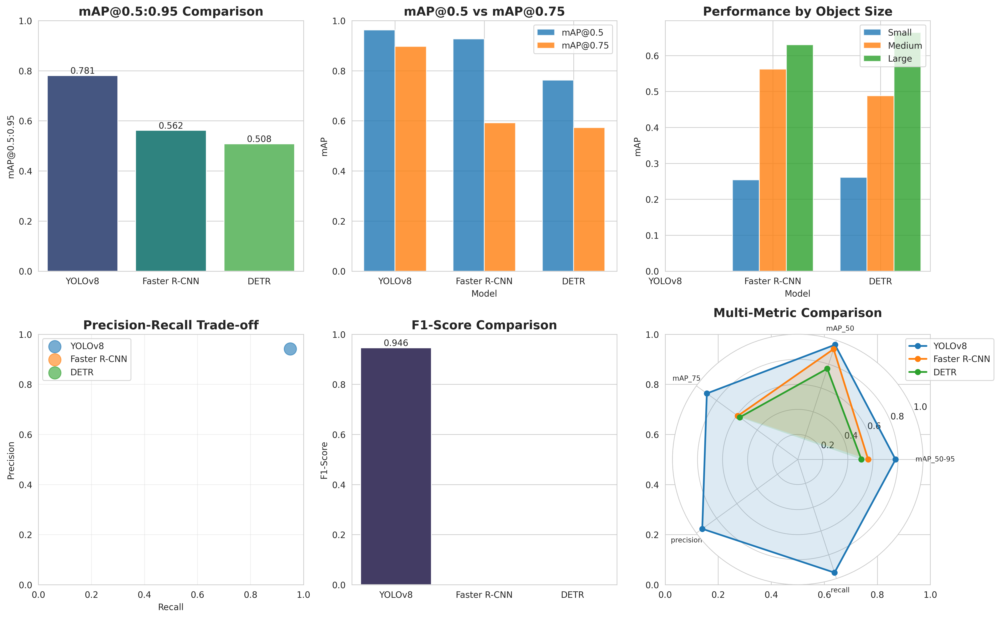
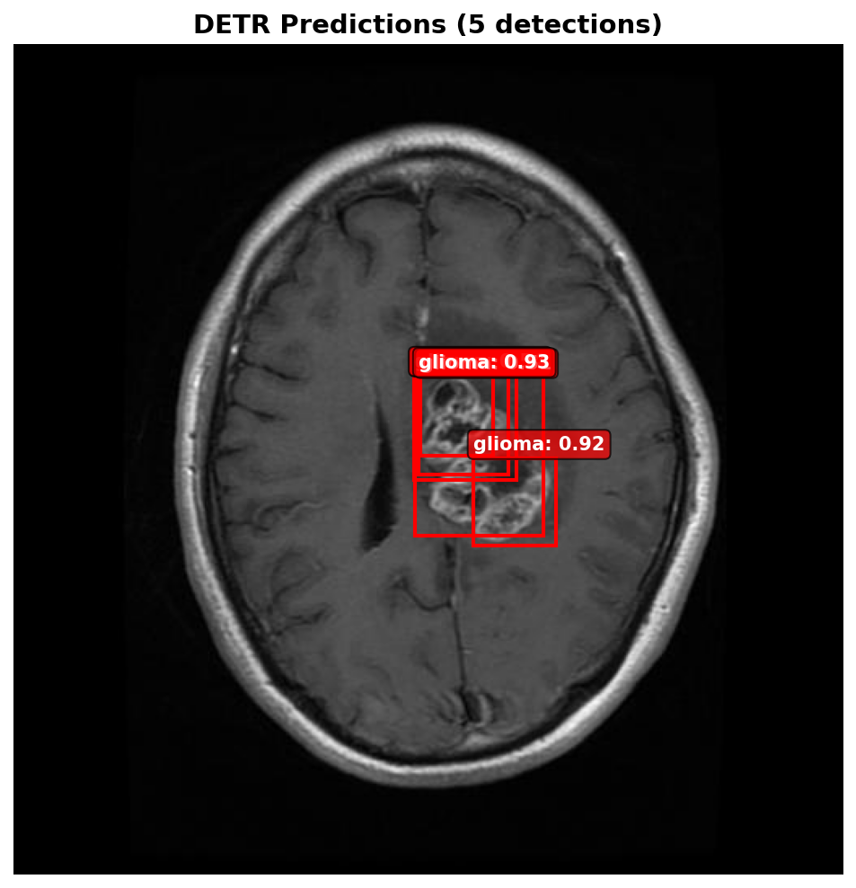
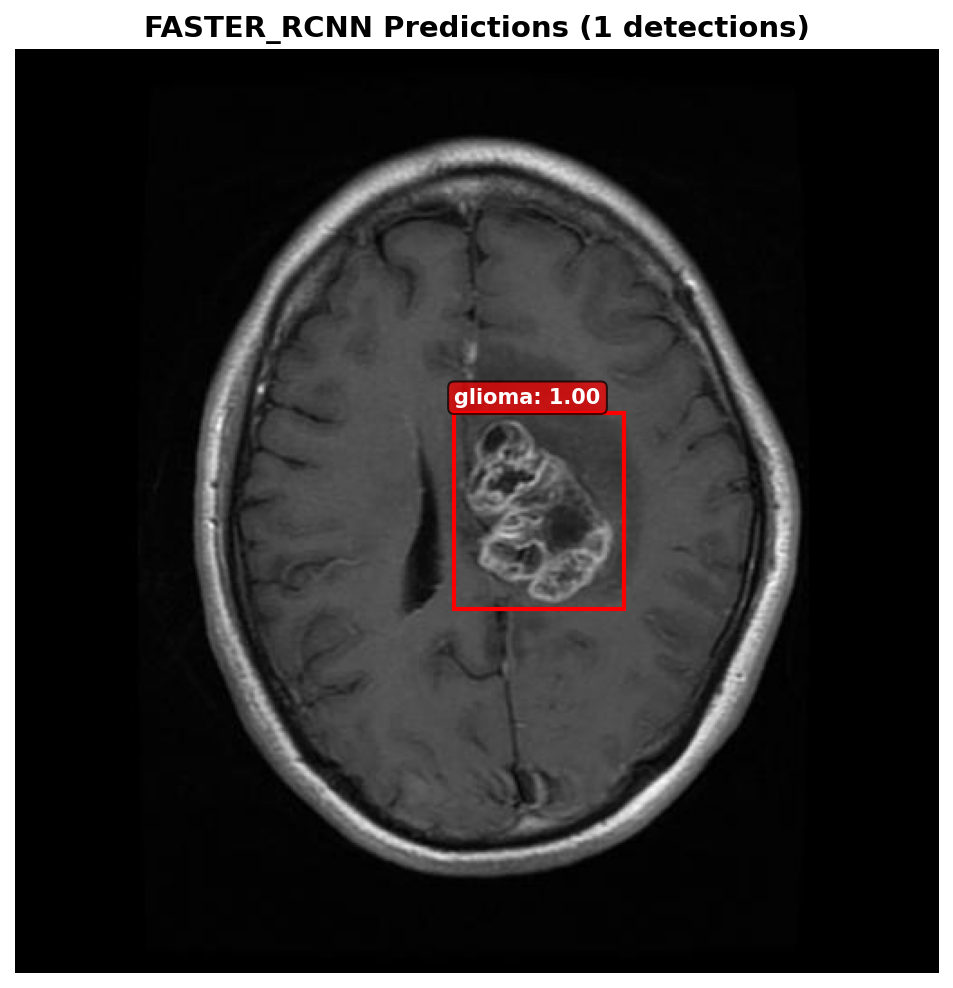
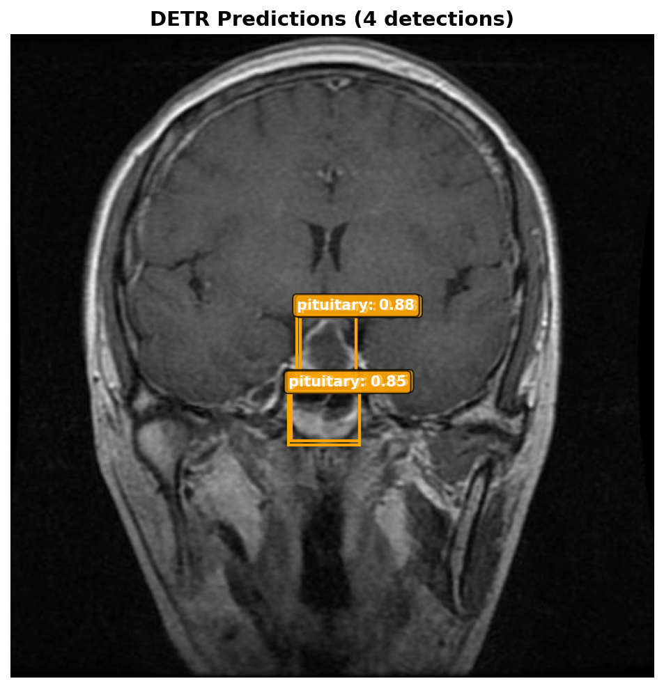
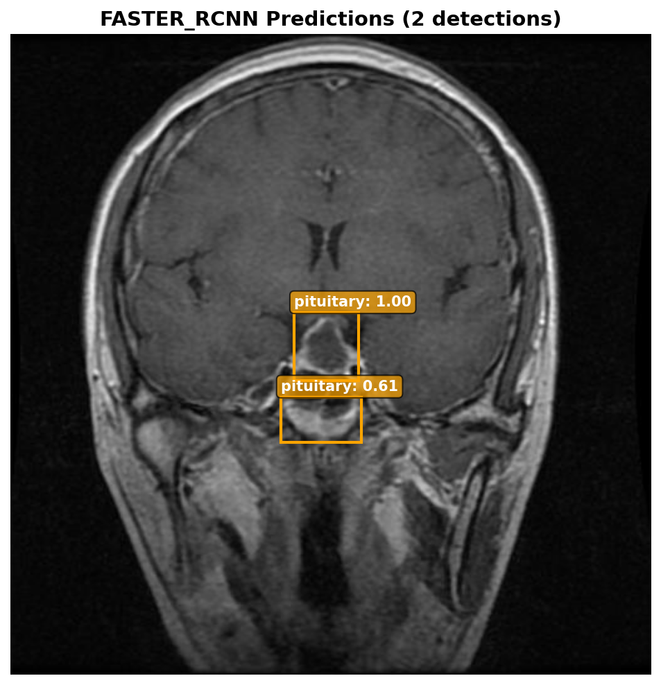
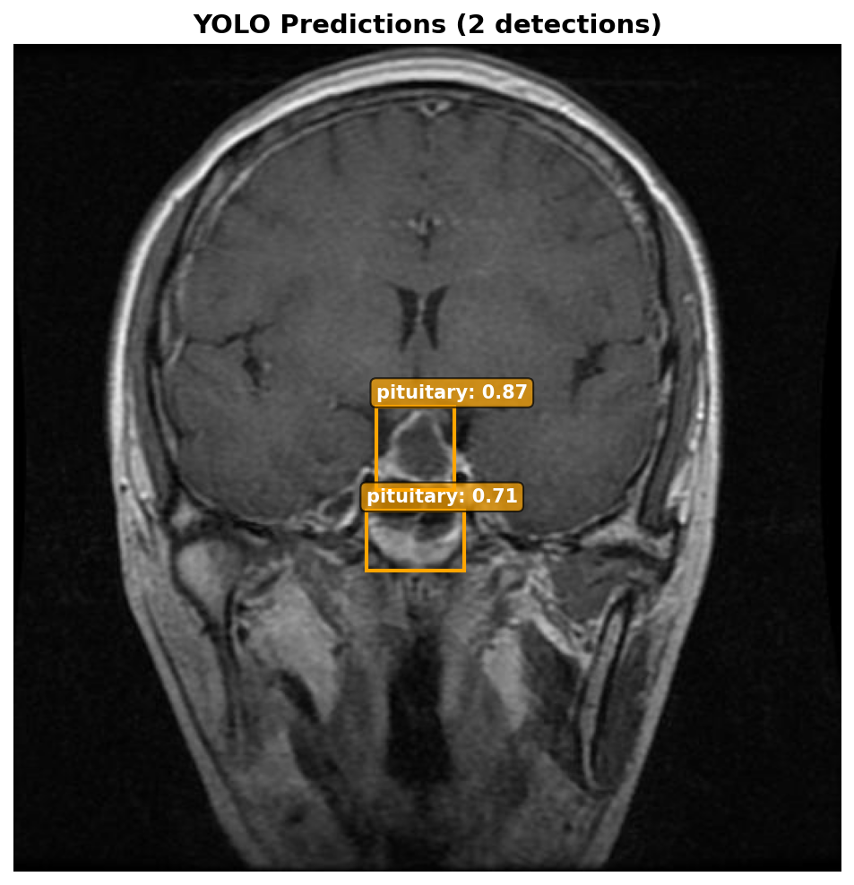
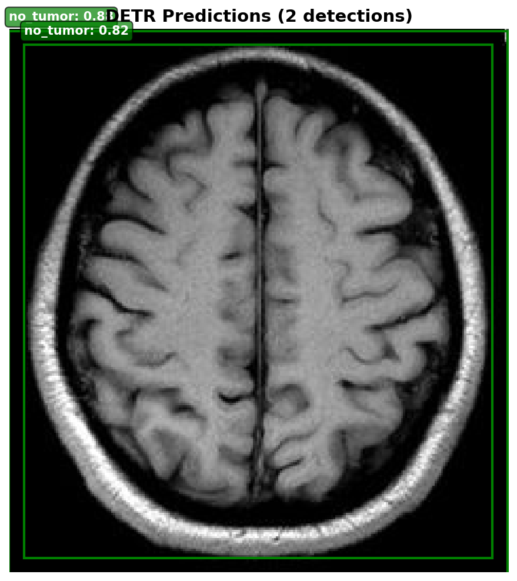
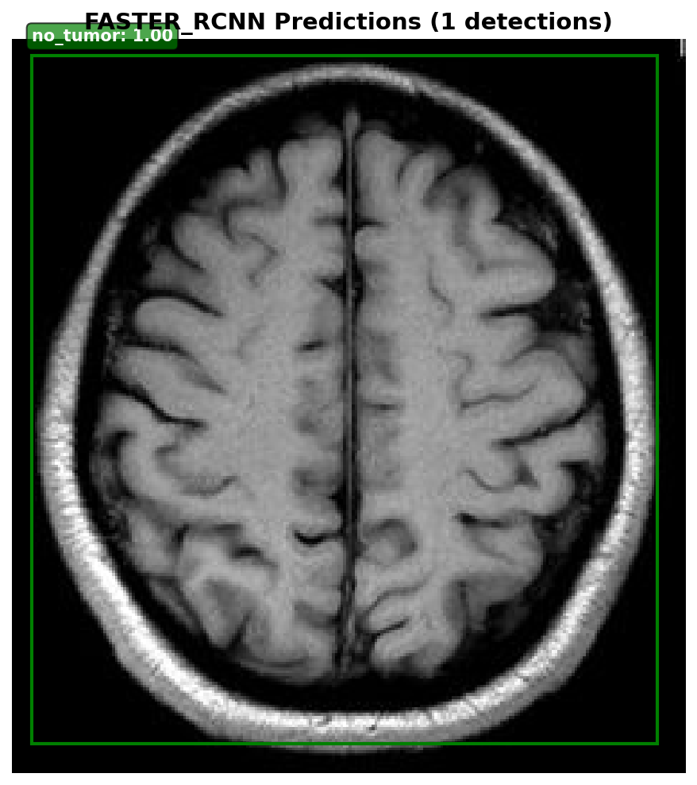
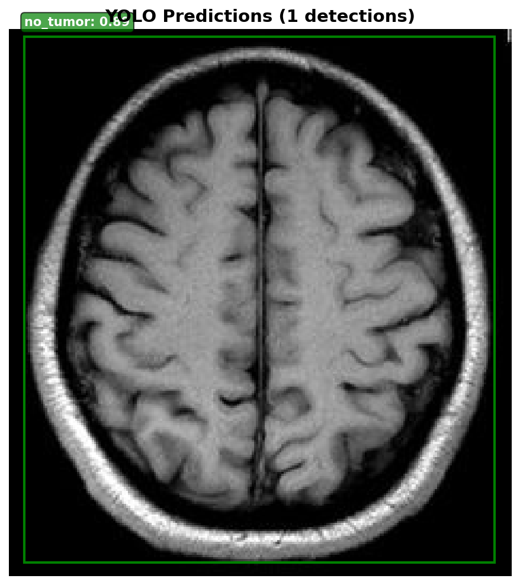

# Brain Tumor Detection in MRI: YOLOv8 vs. Faster R-CNN vs. DETR

A comparative study of three object-detection families — one-stage CNN (YOLOv8), two-stage CNN (Faster R-CNN), and transformer (DETR) — for localizing and classifying brain tumors in MRI slices. All three models are trained on the same data, evaluated with the same COCO metrics, and exposed through a single training pipeline and a single inference script.



## Results

Validation set, 512 images, COCO bounding-box metrics:

| Model | mAP@0.5:0.95 | mAP@0.5 | mAP@0.75 | Precision | Recall | F1 |
|---|---:|---:|---:|---:|---:|---:|
| **YOLOv8m** | **0.781** | **0.963** | **0.897** | 0.942 | 0.950 | 0.946 |
| Faster R-CNN (R101-FPN) | 0.562 | 0.927 | 0.592 | – | – | – |
| DETR (ResNet-50) | 0.508 | 0.762 | 0.573 | – | – | – |

mAP by object size:

| Model | Small | Medium | Large |
|---|---:|---:|---:|
| Faster R-CNN | 0.254 | 0.562 | 0.630 |
| DETR | 0.261 | 0.488 | 0.664 |

Observations:

- YOLOv8m is the strongest model on every metric, with a 0.22 absolute mAP@0.5:0.95 margin over Faster R-CNN.
- Faster R-CNN is close to YOLOv8 at IoU 0.5 (0.927 vs. 0.963) but falls behind at IoU 0.75 (0.592 vs. 0.897): it finds the tumors but localizes them less tightly.
- DETR has the lowest overall score but the best large-object mAP of the two COCO-evaluated models, consistent with its known weakness on small objects and its need for longer training schedules and more data.
- Small lesions are the hard case for both Faster R-CNN and DETR (mAP ≈ 0.26).

Full metrics are in [`results/`](results/); YOLO training curves and confusion matrices are in [`src/runs/detect/mri_yolo_v2/`](src/runs/detect/mri_yolo_v2/).

## Sample predictions

| DETR | Faster R-CNN | YOLOv8 |
|:---:|:---:|:---:|
|  |  |  |
|  |  |  |
|  |  |  |

Rows: glioma, pituitary, no tumor.

## Dataset

[MRI for Brain Tumor with Bounding Boxes](https://www.kaggle.com/datasets/ahmedsorour1/mri-for-brain-tumor-with-bounding-boxes) (Kaggle), four classes with YOLO-format box annotations.

| Class | Train images | Train boxes | Val images | Val boxes |
|---|---:|---:|---:|---:|
| Glioma | 1,152 | 1,349 | 135 | 153 |
| Meningioma | 1,442 | 1,482 | 140 | 142 |
| Pituitary | 1,671 | 1,775 | 154 | 161 |
| No tumor | 711 | 711 | 101 | 98 |
| **Total** | **4,737** | **5,317** | **512** | **554** |

`src/prepare_data.py` merges the per-class folders into a single YOLO dataset and converts the labels to COCO JSON so that all three frameworks train on identical images and boxes. EDA plots are in [`src/data/eda/`](src/data/eda/).


## Models and training

| | YOLOv8m | Faster R-CNN | DETR |
|---|---|---|---|
| Framework | Ultralytics | Detectron2 | Hugging Face Transformers + PyTorch Lightning |
| Initialization | COCO-pretrained `yolov8m.pt` | COCO-pretrained R101-FPN 3x | `facebook/detr-resnet-50` |
| Schedule | 70 epochs | 24,000 iterations | 60 epochs |
| Batch size | 16 | 8 | 4, gradient accumulation ×4 |
| Input size | 512 | short side 512–640 (multi-scale), max 1024 | 512 × 512 |
| Optimizer | AdamW, lr 1e-3, cosine | SGD, lr 1e-3, warmup + cosine | AdamW, lr 1e-4 (backbone 1e-5), OneCycle |
| Mixed precision | yes | yes | yes |
| Class imbalance | – | repeat-factor sampling | class-weighted classification loss |

Design choices specific to MRI:

- **Anatomy-preserving augmentation.** Horizontal flips and small rotations (±10–15°) are used; vertical flips and perspective transforms are disabled. Hue jitter is kept minimal.
- **CLAHE** contrast enhancement in the DETR pipeline.
- **Extended anchor sizes** (8–512 px) for Faster R-CNN to cover small lesions.
- **Gradient clipping** (0.1) and separate backbone learning rate for DETR.

Training was run on an NVIDIA RTX A5000 (24 GB) and tracked with Weights & Biases.

## Project structure

```
├── pipeline.py                 # end-to-end runner: data → EDA → train → evaluate → compare
├── predict.py                  # inference with one or all models on a single image
├── configs/yolo_data.yaml
├── src/
│   ├── prepare_data.py         # merge class folders, YOLO → COCO conversion
│   ├── eda.py                  # class/instance statistics and plots
│   ├── data_loader.py          # Albumentations transforms
│   ├── train_yolo.py
│   ├── train_faster_rcnn.py
│   ├── train_detr.py
│   ├── evaluate.py             # COCO evaluation for all three models
│   ├── compare.py              # comparison charts and report
│   └── utils.py                # visualization helpers
├── results/                    # metrics (CSV/JSON), comparison report and chart
├── predictions/                # sample outputs
└── runs/, src/runs/            # YOLO training and validation artifacts
```

## Setup

```bash
git clone https://github.com/mksl49/brain-tumor-detection-MRI.git
cd brain-tumor-detection-MRI
pip install -r requirements.txt
```

Download the dataset from Kaggle and place it under `data/raw/` as `train/<Class>/{images,labels}` and `val/<Class>/{images,labels}`.

The scripts currently use absolute paths from the training server (`/home/likhon/zksl/lmn/mri/project/...`). Update these in `pipeline.py`, `configs/yolo_data.yaml`, and the `src/` scripts, or pass `--src-dir` to `pipeline.py`.

## Usage

Run the whole pipeline:

```bash
python pipeline.py --src-dir ./src
```

Train selected models or skip stages:

```bash
python pipeline.py --src-dir ./src --skip-data --skip-eda --models yolo detr
```

Predict on an image with all three models (results are saved to `predictions/`):

```bash
python predict.py path/to/image.jpg --models all --threshold 0.5
```

Expected weight locations:

```
src/runs/detect/mri_yolo_v2/weights/best.pt
src/checkpoints/detr/final_model.pth
output/faster_rcnn_*/model_final.pth
```

## Limitations and future work

- Single train/validation split; no held-out test set or cross-validation, and no multi-seed runs.
- DETR and Faster R-CNN were trained on a limited compute budget; longer schedules and Deformable DETR / RT-DETR are natural next comparisons.
- The dataset is 2D slices from a public source; results do not establish clinical validity.
- Precision/recall/F1 are reported only for YOLOv8 in the comparison table; per-class and per-size analysis for all three models under one evaluator is still to be added.

## License

MIT
